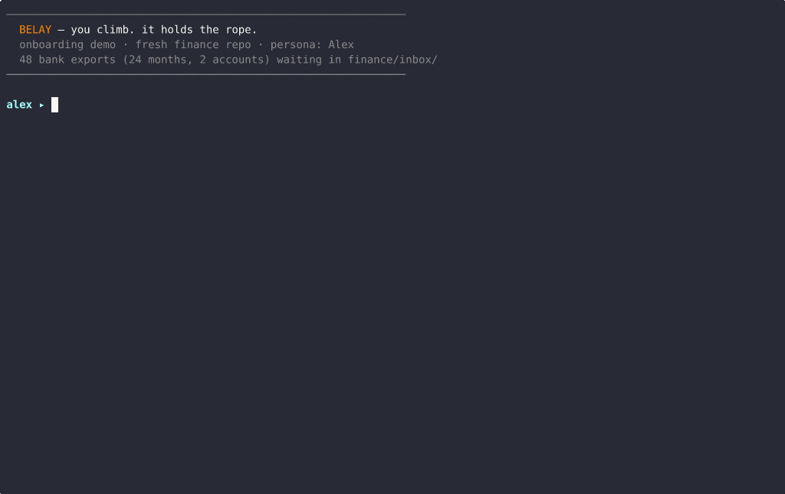
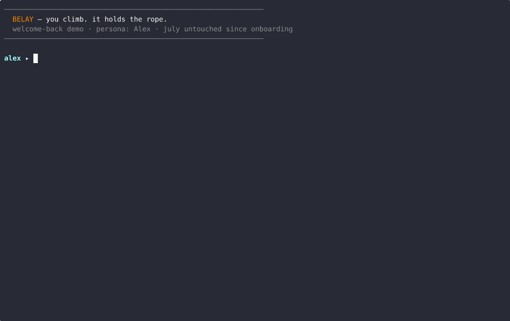
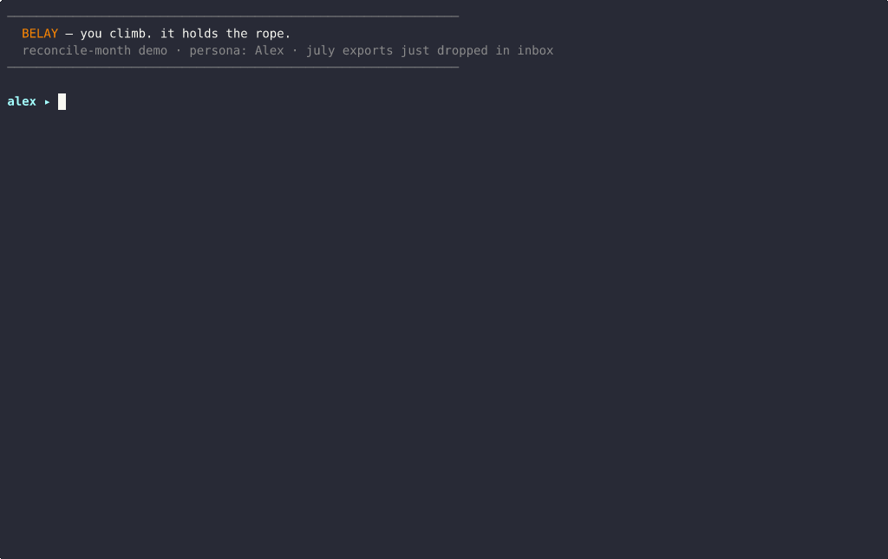
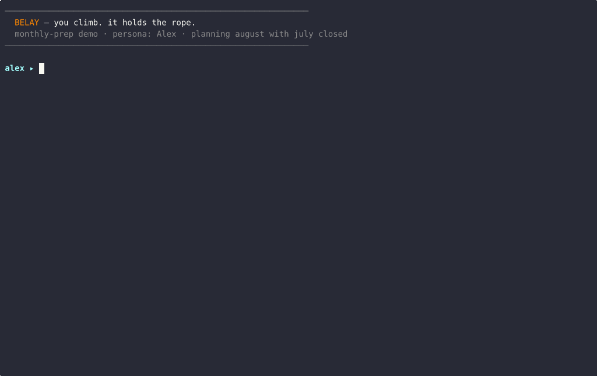
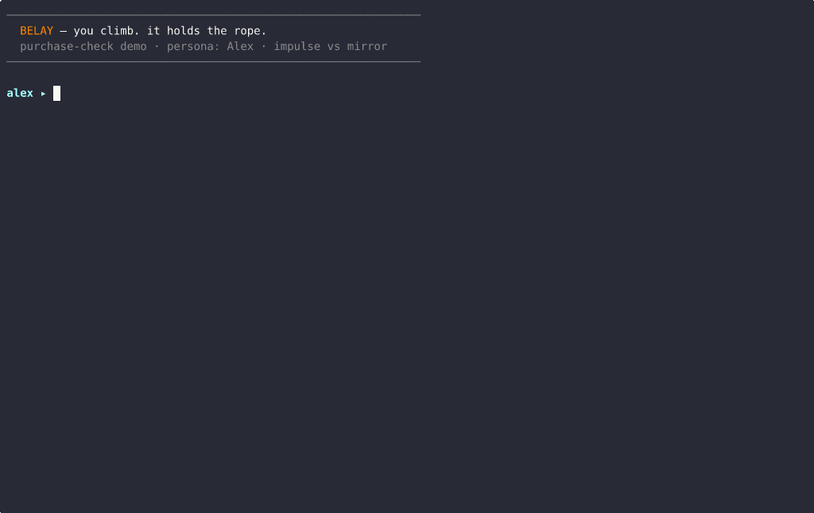
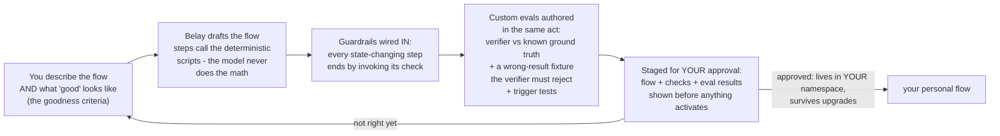
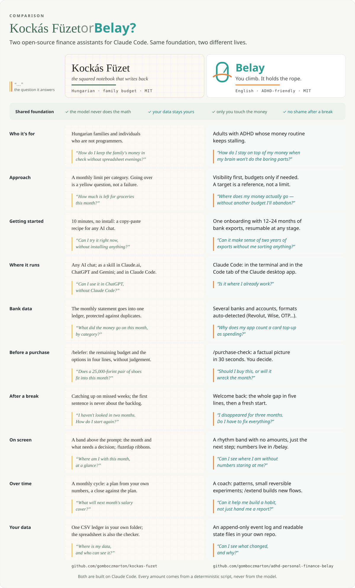

<p align="center">
  
</p>

<h1 align="center">Belay</h1>

<p align="center"><b>You climb. It holds the rope.</b><br>
A shame-free personal-finance companion for ADHD brains, built as a Claude Code harness.</p>

---

In climbing, the *belayer* is the partner who holds your rope — mostly invisible,
always attentive, and the reason a slip is an event, not a fall. Belay does that for
your money: it ingests your real bank exports, learns what your transactions mean,
and then carries the executive function of a monthly money rhythm — planning,
reconciliation, and behavioral coaching — so you don't have to hold it all in your
head.

**Philosophy: awareness over budgeting, structure as optional equipment.** Belay
starts by making money *visible* without judgment. Where visibility alone isn't
enough, it *proposes* small reversible steps — one envelope, one category, with a
review date. Envelope budgeting is a destination some users converge to, never a
prerequisite. And the make-or-break scenario is designed in: coming back after a
missed month (or three) is a five-minute, zero-shame catch-up — never a wall of
overdue tasks. **The win is that you came back.**

## Install

Into any git repo you want to keep your finances in (a fresh empty one is fine):

```bash
# from this repo
git clone https://github.com/gomboczmarton/adhd-personal-finance-belay
uv run adhd-personal-finance-belay/install.py /path/to/your-finance-repo

# or straight from the latest release
uv run install.py /path/to/your-finance-repo --from-release

cd /path/to/your-finance-repo && claude
> /onboarding
```

Requirements: Python 3.11+, [uv](https://docs.astral.sh/uv/),
[Claude Code](https://claude.com/claude-code).

## What you get

| Skill / agent | When |
|---|---|
| `/onboarding` | Once: drop 12–24 months of bank exports (CSV/XLSX — known banks are auto-detected, a mapping wizard adapts to any other), answer a handful of evidence-backed questions, get your workspace and first budget. Resumable at every stage. |
| `/monthly-prep` | Start of month: a drafted budget from your history, yearly items due this month pre-filled and highlighted, transfer checklist for your banking app. |
| `/reconcile-month` | End of month: exports in → deduped, transfers matched, categorized, plan-vs-actual story + Excel view. Overspend is information, not failure. |
| `/purchase-check` | "Should I buy this?" — a 30-second factual impact picture. You decide; Belay is the mirror, not the parent. |
| `/welcome-back` | Been away? The whole gap summarized in five lines and a fresh start. |
| `finance-coach` agent | The journey layer: pattern reflections, small reversible experiments, goal check-ins. |
| `/extend` | Belay grows around you: describe a flow you wish existed and Belay builds it — **with its own checks and tests, in the same act**. See "Belay builds its own flows" below. |
| Terminal surface | A status line (`◉ Belay · October · plan ✓ · next /purchase-check`), climbing spinner verbs and tips — plus, where Claude Code's mods are on, a rhythm band above the prompt and `/belay`, the month at a glance. The always-visible parts never show an amount, and after a break they only say *good to see you*. Numbers live in `/belay`, straight from the scripts. |

Bank formats with built-in auto-detection: Revolut, Wise, N26, Monzo CSV; OTP
netbank XLSX; generic EU / Hungarian CSV shapes. Anything else goes through the
interactive mapping wizard once and is remembered.

## See it before you run it

- [`examples/sample-monthly-report.html`](examples/sample-monthly-report.html) — a
  closed month as Belay presents it: a coach's letter first (one win leads), energy
  meters where numbers need shape, the full statement table one layer down.
- [`examples/demo-workspace/`](examples/demo-workspace/) — a complete synthetic
  workspace six months into the journey: readable markdown state, an append-only
  ledger, budgets with a yellow-flagged yearly item, and one freshly adopted
  envelope experiment. Every file is what your own `finance/` folder would look
  like. (All data is synthetic by construction — no real person's finances appear
  anywhere in this repository.)

## See it in motion — one user's first month, recorded

Six real, recorded Claude Code sessions in one continuous workspace, played as
the synthetic persona **Alex** (24 months of exports, two accounts, a card
refilled from checking — the classic setup every finance app miscounts). In
order, they are the way Belay is meant to be lived: onboard once, then the
monthly rhythm. Model wait-time is compressed in the GIFs; the raw asciinema
casts and the findings the demo surfaced are in
[`examples/demo-sessions/`](examples/demo-sessions/).

### 1 · `/onboarding` — exports in, workspace out

Belay finds the exports on its own, auto-detects one bank dialect and sniffs
the other, matches all 96 card-refill pairs (not income!), surfaces a
subscription Alex thought was cancelled, recommends awareness mode **by rule**
(no envelope structure in the data → no imposed structure), and computes the
buffer goal from history instead of asking Alex to guess. It also catches a
mid-month planning pitfall and writes the workspace memory (`CLAUDE.md` +
`finance/strategy.md`) that later sessions visibly build on.



### 2 · `/welcome-back` — the make-or-break re-entry

Alex returns guilty ("didn't open it once, July is basically over"). The first
sentence is warm; the gap is restated as fact — "July is just… not in the
system. Not a missed thing, just an empty one." One small door is offered, and
when Alex takes the exit instead, that's treated as a full, correct outcome.
**The win is that you came back.**



### 3 · `/reconcile-month` — July closed in one turn

Exports dropped in, month closed: 18 transactions auto-categorized from the
merchant map, the €420 annual car insurance recognized on sight (flagged since
onboarding), and Alex's accidentally re-downloaded overlapping statements
deduped — 427 duplicate rows skipped, zero double-counting. Letter, HTML
report, and Excel written; overspend, had there been any, is information, not
failure.



### 4 · `/monthly-prep` — August planned, averages protected

The draft refreshes every target from the newest three months — except where
that would lie: July's insurance spike would have tripled the car target
(€214 instead of €73), so it's excluded from the rolling average, with the
reasoning shown. One open question ("anything unusual this month?") turns a
€200 coast trip into a user-sourced overlay line that won't skew future
baselines.



### 5 · `/purchase-check` — the mirror, not the parent

"€340 espresso machine, should I?" Four factual lines: July's actual surplus,
August's drafted surplus, the buffer-goal effect — then options, no verdict.
Alex chooses to wait ("knowing it fits kills half the urge") and the *decision*
is logged as a win worth remembering.



### 6 · `finance-coach` — the journey layer

A check-in, not a report: one theme, evidence instead of adjectives, the logged
espresso win reflected back, the zombie subscription gently resurfaced — and,
correctly, **nothing proposed**, because one clean month is not yet a pattern.
The next touchpoint is named and the session ends warm.


## Belay builds its own flows — `/extend`

Belay is not a fixed menu. Tell it about a routine you keep repeating ("every
payday I move rent, top up the card, log the savings sweep — can that just be
one command?") and `/extend` builds the flow. What makes this safe rather than
scary is the iron rule the whole system runs on: **no flow without
evaluation** — a new flow, its wired-in checks, and its tests are one
deliverable, created together, and nothing becomes active until you approve it.



The same discipline covers the flow's *triggering*: `/extend` adds test
phrases proving your new flow fires when you'd naturally ask for it — and
that Belay's engineering tools never wake up during money conversations
("optimize my spending" gets budget coaching, not a systems process). The
full design is in [`docs/architecture.md`](docs/architecture.md); a flow that
proves great in your instance can be offered back to the community
(anonymized — see [`CONTRIBUTING.md`](CONTRIBUTING.md)).

## Why you can trust the numbers

- **The model never does arithmetic.** All money math — parsing, dedup, transfer
  matching, reconciliation, budget verification — runs in deterministic Python
  scripts (`harness/scripts/`), exact to the cent in `Decimal`.
- **Internal transfers are never income.** Credit-card refills and own-account
  sweeps are matched and excluded — the classic failure of finance apps on
  envelope-style banking.
- **Re-importing is always safe.** Content-hash dedup means overlapping exports add
  zero duplicates, ever.
- **Tested like software, and like a conversation.** The full eval suite lives
  in this repo and gates every change: **seven synthetic personas** (from a
  clean baseline to a four-bank multibanker and a feast-or-famine freelancer)
  with seeded generators and ground-truth manifests, **nine Harbor-format
  tasks** whose verifiers independently recompute every number — and every
  verifier must first reject a plausible-but-wrong result before it's trusted.
  Conversational behavior is judged against a shame-free rubric. Releases
  additionally pass a **fresh-seed gate**: all fixtures are regenerated with
  new seeds and the suite must stay green on ground truth nobody has seen —
  memorized answers can't pass it.

## Your data stays yours

Everything lives in *your* repo: readable markdown plus an append-only ledger under
`finance/`. Nothing is uploaded anywhere except through the Claude API calls that
power the conversation itself. Delete the folder and it's gone.

## Sister project: Kockás Füzet

Belay has a Hungarian sibling built on the same foundation:
[Kockás Füzet](https://github.com/gomboczmarton/kockas-fuzet), a family-budget
notebook whose first step is a copy-paste recipe for any AI chat. Same rules,
different lives. The differences at a glance, with the question each one
answers:

[](docs/comparison.md)

The same as a table: [`docs/comparison.md`](docs/comparison.md).

## Version

Licensed under the [MIT License](LICENSE).

v0.1.0 — first public cut. Since the D16 consolidation this repo is the whole
project: the harness, its full eval suite, its design history
([`docs/decisions.md`](docs/decisions.md)), and its build machinery live here
together — engineering tools cleanly separated from your money conversations
by tested activation planes ([`docs/architecture.md`](docs/architecture.md)).
Releases are git tags: the release workflow re-proves the full suite, runs the
fresh-seed gate and a sanitization scan, then publishes the packaged harness
(`dist/harness.zip` on GitHub Releases, consumed by `install.py --from-release`).

## Your instance: private copy, never a fork

Belay is a template you copy, not a repo you fork: use GitHub's **Use this
template**, or clone and push to a **new private repository**. Never use the
Fork button — forks of public repos cannot be made private, and your instance
will contain your financial data and personal tailoring.

Your instance has two kinds of paths: **harness-owned** (`.claude/skills/` of
shipped skills, `harness/scripts/`, `harness/schemas/` — overwritten when you
upgrade by re-running `install.py`) and **yours** (`finance/`, any
`*-local` additions — never touched by upgrades). Belay's meta layer can build
you new flows on request; each one ships with its own checks and tests, and
nothing is adopted without your approval. To offer a flow you built back to
the community, open an issue — personal data never leaves your instance (see
CONTRIBUTING.md).
