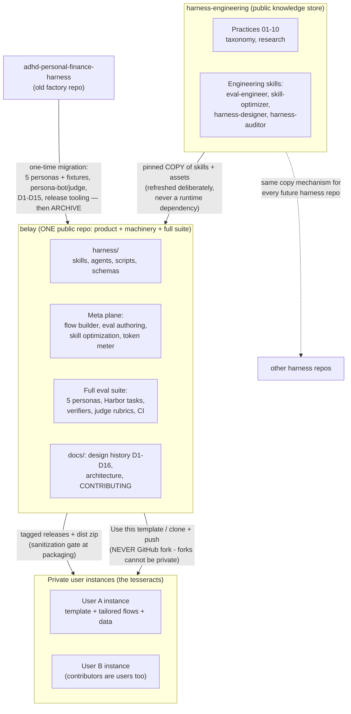
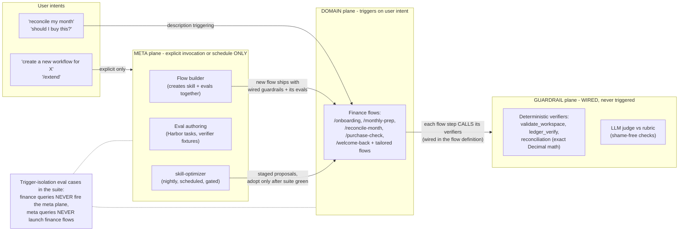
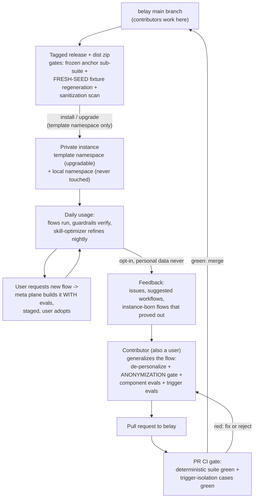

# Belay ecosystem architecture

Final topology decided 2026-07-23 (decision record: harness-engineering store,
`research/2026-07-23-factory-product-topology.md` and `docs/19`–`docs/25`).
Three diagrams: the repo ecosystem, the activation planes inside Belay, and
the flow-of-flows loop (how user-created flows become part of Belay).

## 1. The ecosystem — repos and how knowledge/artifacts move

## 2. Inside Belay — the three activation planes

Same repo, three capability planes, **three different activation mechanisms**
(practices/05 §Activation planes). This is what makes shipping the machinery
safe for a user who "just wants to install and use."

## 3. The flow of flows — usage, feedback, contribution, release

Contributors are users: they experiment in their own instances, and what
proves out gets generalized into Belay through the gated path.

## The rules that hold it together

1. **Flows trigger, guardrails wire, meta invokes** — a gate left to
   probabilistic skill-triggering is not a gate; every flow calls its
   verifiers as steps. Plane isolation is itself eval-tested.
2. **No flow without evals** — the old factory's iron rule #1, now a runtime
   law: the flow builder creates the flow's evals and wired guardrails at
   creation, in the instance exactly as in the repo.
3. **Instances are private template copies, never GitHub forks** — forks of
   public repos cannot be made private, and instances hold personal data.
4. **Two namespaces in every instance** — template-owned paths (upgrades may
   overwrite) vs local paths (upgrades never touch).
5. **Anonymization at the contribution edge** — instance-born content passes
   the sanitization mindset (previously the release gate) before it enters a
   PR; personal data never leaves the instance.
6. **Key-free by design** — verification and self-extension run on the user's
   Claude subscription alone (deterministic verifiers, in-session judging,
   mock/handoff optimization backends).
7. **The store feeds by copy** — harness-engineering knowledge and skills
   arrive as pinned snapshots, refreshed deliberately; no runtime dependency.
