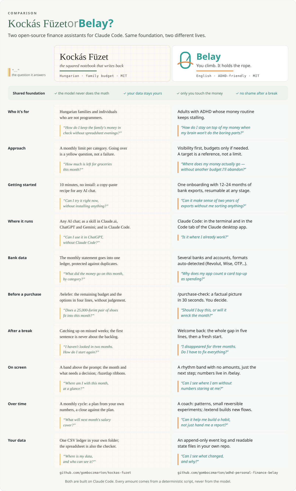

# Kockás Füzet or Belay?

Two open-source finance assistants for Claude Code. Same foundation, two different lives.

## Shared foundation

- The model never does the math
- Your data stays yours
- Only you touch the money
- No shame after a break

## In detail

|  | Kockás Füzet | The question it answers | Belay | The question it answers |
|---|---|---|---|---|
| **Who it's for** | Hungarian families and individuals who are not programmers. | *“How do I keep the family's money in check without spreadsheet evenings?”* | Adults with ADHD whose money routine keeps stalling. | *“How do I stay on top of my money when my brain won't do the boring parts?”* |
| **Approach** | A monthly limit per category. Going over is a yellow question, not a failure. | *“How much is left for groceries this month?”* | Visibility first, budgets only if needed. A target is a reference, not a limit. | *“Where does my money actually go — without another budget I'll abandon?”* |
| **Getting started** | 10 minutes, no install: a copy-paste recipe for any AI chat. | *“Can I try it right now, without installing anything?”* | One onboarding with 12–24 months of bank exports, resumable at any stage. | *“Can it make sense of two years of exports without me sorting anything?”* |
| **Bank data** | The monthly statement goes into one ledger, protected against duplicates. | *“What did the money go on this month, by category?”* | Several banks and accounts, formats auto-detected (Revolut, Wise, OTP…). | *“Why does my app count a card top-up as spending?”* |
| **Before a purchase** | /belefer: the remaining budget and the options in four lines, without judgement. | *“Does a 25,000-forint pair of shoes fit into this month?”* | /purchase-check: a factual picture in 30 seconds. You decide. | *“Should I buy this, or will it wreck the month?”* |
| **After a break** | Catching up on missed weeks; the first sentence is never about the backlog. | *“I haven't looked in two months. How do I start again?”* | Welcome back: the whole gap in five lines, then a fresh start. | *“I disappeared for three months. Do I have to fix everything?”* |
| **Over time** | A monthly cycle: a plan from your own numbers, a close against the plan. | *“What will next month's salary cover?”* | A coach: patterns, small reversible experiments; /extend builds new flows. | *“Can it help me build a habit, not just hand me a report?”* |
| **Your data** | One CSV ledger in your own folder; the spreadsheet is also the checker. | *“Where is my data, and who can see it?”* | An append-only event log and readable state files in your own repo. | *“Can I see what changed, and why?”* |

## Which one is for you?

- **Kockás Füzet** if you think in Hungarian and as a family, want to start from a spreadsheet, and want to try it today without installing anything.
- **Belay** if you live with ADHD (or the routine is simply the hard part), have several bank accounts, and want to see where the money goes before planning anything.

## Where to find them

- Kockás Füzet — [github.com/gomboczmarton/kockas-fuzet](https://github.com/gomboczmarton/kockas-fuzet) · *the squared notebook that writes back*
- Belay — [github.com/gomboczmarton/adhd-personal-finance-belay](https://github.com/gomboczmarton/adhd-personal-finance-belay) · *You climb. It holds the rope.*

Both run on Claude Code. Every amount comes from a deterministic script, never from the model.

*This page describes both repositories' `main` branches (October 2026). The graphic is built from this same table: [`assets/kockas-fuzet-vs-belay.svg`](../assets/kockas-fuzet-vs-belay.svg).*
